# Patterns for 3D reels: how the creator invents (explainer3d + voxel)

Read this before the storyboard of any `explainer3d` or `voxel` reel, and paste section 3 (the invention method) into every
scene builder's brief. It is the 3D companion of `guides/patterns.md`.

**Why this exists.** The kits (`kits/studio.js`, `city.js`, `gadgets.js`, voxel `shopfront.js`) are the props the creator
invented for HIS earlier reels: the charge orbs, wire grid and hand came from the touchscreen reel, the coin tracker and handset
from the tracker reel, the shopfronts and street from the coffee-shop reel. Building a new reel out of them is borrowing someone
else's idea. Two buyer tests did exactly that and came out correct but flat:

| test | what it did | motion (target) | craft |
|---|---|---|---|
| noise-cancelling headphones (explainer3d) | one headphone model + 2D-looking wave lines in a black void, the same wave prop 17 times, `makeCharges` 4 times | 9.5 (11+) | 24 lines/s, 1.4 helpers/s, 8 builders |
| bakery (voxel) | the coffee reel's street, shopfronts and sign cards re-skinned as bakeries; ideas shown as paper cards (clock, checklist) | 15 (16+) | 26 lines/s, 0.7 helpers/s, 1 geometry built |

The creator's reels instead invent a **world** per script: a city of relay phones, a road that cracks into tiles and stacks into a
tower, a phone that explodes into a glass lid, a wire grid and a field of charge pillars, a toy street where a speech bubble
bounces off headphones. That is the job. Kits are building blocks; your idea must be new code.

---

## 0. The reference reels

Four finished 1080x1920 reels. Their scene code ships de-branded in `library/explainer3d/` and `library/voxel/`; the strips below
are frames from the finals (time under each frame).

| code | topic (generic) | look | length / beats | central visual |
|---|---|---|---|---|
| **T** | tracker relay network: how a coin tracker in a lost suitcase is found with no GPS or SIM | city | 57 s / 12 (avg 4.7 s) | a city full of strangers' phones that overhear the tag and post sealed notes to a cloud vault |
| **E** | arrival-time forecast: how a navigation app predicts your arrival 20 minutes ahead | city | 70 s / 12 (avg 5.9 s) | your route as a physical ribbon that cracks into 8 tiles, gets painted by live and past traffic, and stacks into a tower of minutes |
| **S** | touchscreen sensing: why a screen ignores a hard pen but feels a light finger | studio | 74 s / 14 (avg 5.2 s) | the phone explodes into layers: a hidden wire grid with a charge orb at every crossing that your fingertip drains |
| **C** | two coffee shops: "be for someone, not everyone" (marketing) | voxel | 56 s / 15 (avg 3.7 s) | a toy street where each strategy is a character with a signature prop (megaphone vs magnifier) and every claim is a physical gag |

Reel T, hook and x-ray, then the lonely signal and the relay:
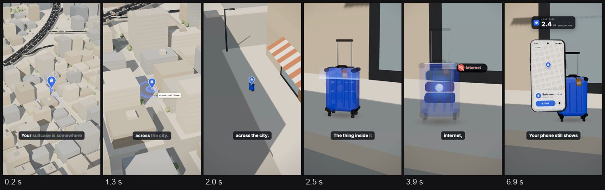
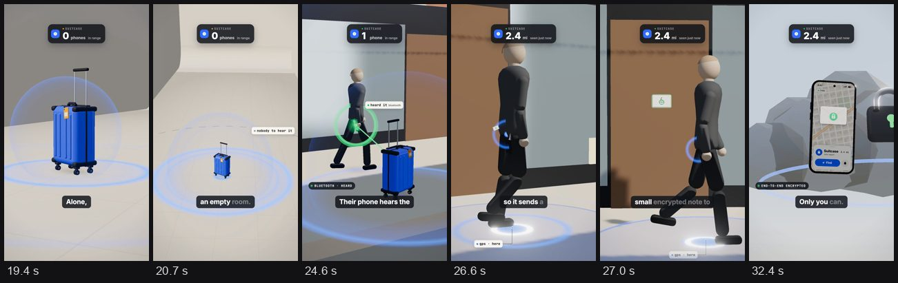
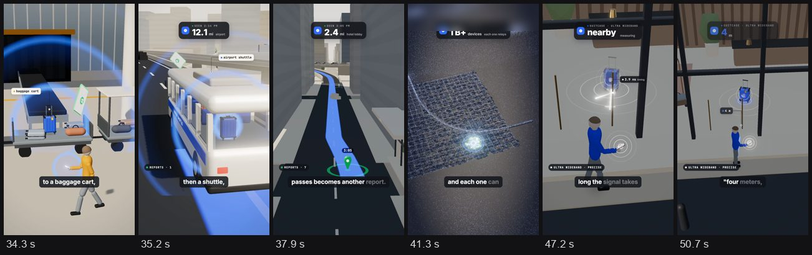

Reel E, route to tiles, live and past traffic, the ripple, the network, the stack:
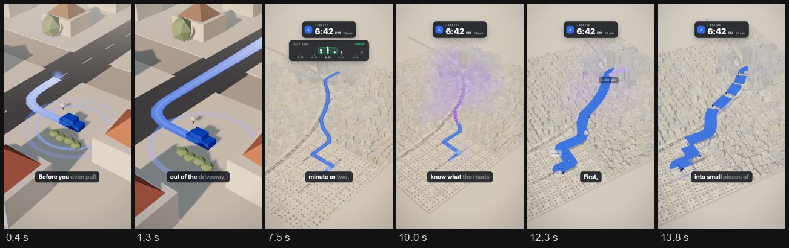
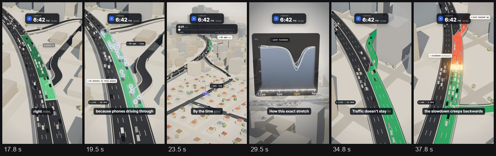
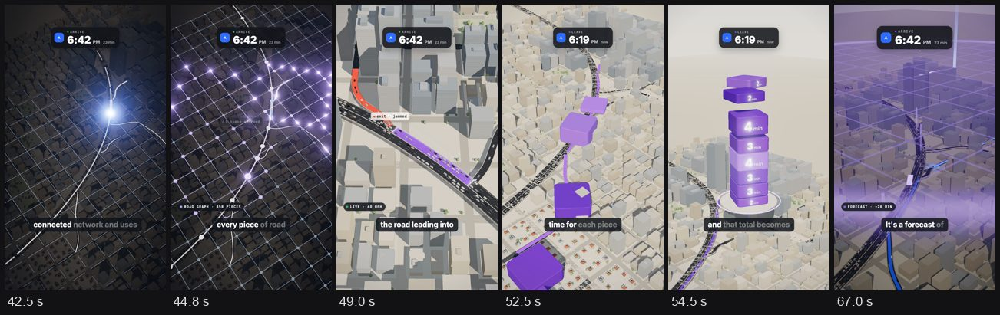

Reel S, the contrast hook, the exploded grid, the body as conductor:
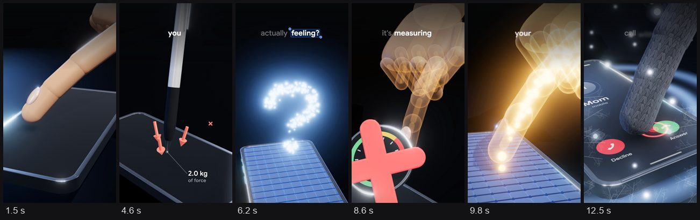
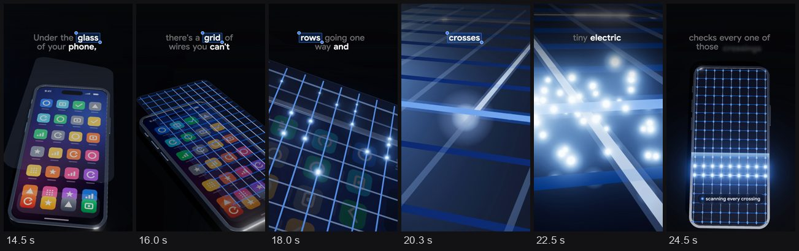
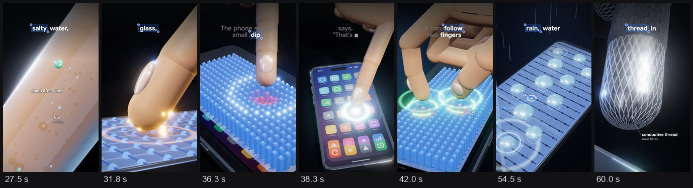

Reel C (voxel), sets and gags:
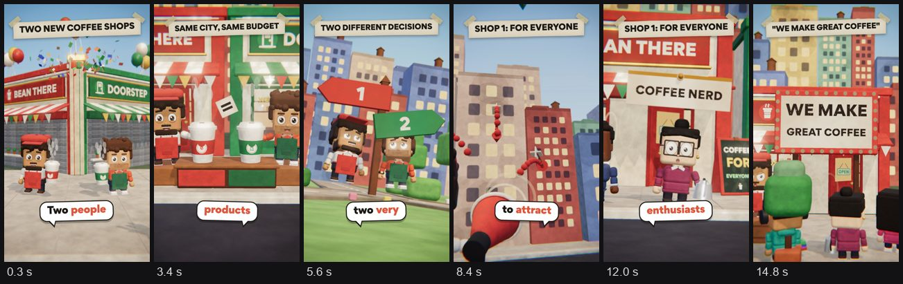
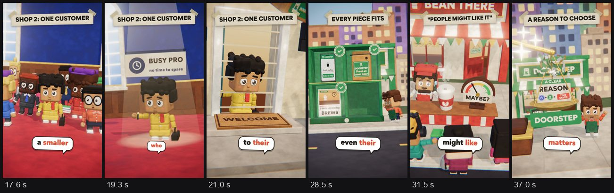
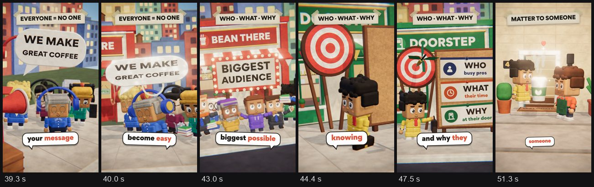

---

## 1. Explainer patterns (what repeats across T, E, S)

1. **One world, many scales (the scale ladder).** Every reel lives in ONE world and moves through 3-5 scales of it. T: 650 m over
   the city → a spiral dive to the bag on the sidewalk (2.7 s, camera distance on a log curve) → x-ray into the pocket → back to
   the street → a crane to a planet of 100k device dots → down into a hotel lobby. E: driveway → whole route → one road piece →
   the whole city as a graph. S: whole phone → glass layer → one wire crossing → all crossings → inside a forearm. The jump
   between scales is the cheapest reliable "wow".
2. **The invisible thing becomes a substance with one colour.** Signal = flat rings and fresnel bubbles (blue). A report = a sealed
   envelope with a padlock (green rim). Speed = paint on the road (green / amber / red). Prediction = violet. Phone charge = blue
   orbs; body electricity = amber current; "nothing happens" = red. The code is fixed for the whole reel and introduced on the
   word that names it.
3. **The abstraction gets a body you could pick up.** "Pieces of road" are tiles that crack apart and spring up with numbers.
   "History" is six translucent slabs (past Tuesdays) standing over the real road with beams tying them to it. "Time for each
   piece" is a block whose height is its minutes; the blocks fly and stack into a tower. "Charge level" is a 3D bar field with a
   red crater under the fingertip.
4. **Agents perform the process.** Not arrows: a stranger walks past with a phone in the back pocket and it wakes; a baggage worker,
   a shuttle passenger and a hotel guest each fire a note; ~400 simulated cars actually brake so the jam queue grows by itself;
   raindrops land and each one acts as a phantom finger.
5. **X-ray and exploded views.** The bag shell ghosts and the tag glows inside; the cover glass lifts off like a lid and the sensor
   layer rises; skin turns to glass and fills with water and ions; the glove's knit turns see-through to show the silver thread.
6. **Contrast pairs carry the hook and the catch.** A feather-light brush wakes the screen, a pen slammed with "2.0 kg" does nothing.
   "No internet, no GPS, no SIM" (three chips struck out) vs "still on a map, down to the street". Alone in an empty hall vs a
   city of phones. Bare finger drains the orbs vs gloved finger, "charge 100%".
7. **A new idea = a new visual language.** When the script changes mode, the picture changes grammar: soft wide rings snap into thin,
   fast, white pulses on "more precise"; the sunny city dims under a dark veil and redraws as a glowing node graph on "network";
   the future rises as a translucent violet copy of the city; "what the phone sees" turns the glass into a bar field.
8. **The machine's point of view.** "For the phone, nobody touched it" is shot top-down from the phone's side, the finger reduced
   to a ghost outline over the orbs. "Every piece of road looks at its neighbours" is the city as the model sees it.
9. **Ride the token.** The camera travels with the thing that moves: the bag from belt to cart to shuttle to lobby (the trail
   glowing behind), the sealed note arcing up the street into the vault, the paper plane in the CTA, the emission ring riding
   back to the bag.
10. **Count, stack, reframe.** Numbers roll on the word (0 → 1 phone in range → 1B+; 6:19 + 23 min = 6:42; 0 g vs 2.0 kg;
    100% → 73%). The last beat restates the idea with the widest shot and a light change (dusk falls over a constellation of
    borrowed phones; a violet future layer over the city).

**Camera storytelling.** Wide (context) → close (mechanism) → wide (scope), repeated inside each explanation. Moves the creator
uses on purpose: the log-distance dive and the spiral pull-back (scale jumps), the crane up to reveal how big it is, low and
along a surface (road, glass, wire), overhead with a 90 degree roll to show a weave, the snap/whip on the contrasting word,
macro on ONE element then pull back to ALL of them (one crossing → every crossing; one phone → a billion), and wipes that hide
a location jump inside a ring burst or an iris (T: city → empty hall → street, no swoop). A camera key every 0.7-1.4 s (the T
hook has 12 keys in 8.5 s); the camera never parks (drift on holds).

**Light and finish, per beat.** Each beat sets a mood: a white empty studio hall for "alone", dusk and warm street lamps for the
ending, a dark veil for abstract layers (graph, dots), a cold blue tint + snow + frost for "winter", amber glow inside the body.
Whites are tuned just under the bloom threshold so only meaningful emitters glow (rings, packet rim, orbs, the tag). Impacts get
anticipation, slam, flex, `ctx.shake` + `ctx.flash` (S: 12 flashes, 18 shakes). Depth of field and a contact shadow sell scale
on small props; the hook's frame 0 is already moving with an exposure punch.

---

## 2. Voxel patterns (what repeats in C)

1. **Each strategy is a character with a signature prop.** The "everyone" owner always has a crate and a megaphone; the "one
   customer" owner has a magnifier; the one customer is a busy pro in a yellow raincoat who checks his watch. Ideas are carried by
   who holds what.
2. **Every claim becomes a physical gag.** "Easy to ignore" = a speech bubble sails at the crowd, bounces off headphones, falls and
   deflates. "Might like" = a MAYBE? meter whose needle can't decide, a tumbleweed, the owner's grin dropping flat. "Matters" = a
   balance scale slams down on one side. "Exactly who" = a dart hits a bullseye above the customer's head. "Everything fits" = a
   2x2 display cubby, one product slots into each cell per word, a check slaps on each.
3. **A set per idea, not one street.** A road that forks under a signpost, a dark stage with a spotlight, a front door with a
   doormat, a counter, a cork board, the display cubby. Two sets inside one beat with a hard cut between (C k07: stage → door).
4. **One thing per stressed word.** A crowd type drops in per word with its own label card and close shot; items land per
   repeated word ("their website / their packaging / their content").
5. **The crowd is a chorus.** Synced blank blinks, everyone turns their back on the sign, a hop wave through the rows, the crowd
   poofs away edge-first until one person is left.
6. **Comic timing.** Anticipation, slam (shake + dust), a beat of deadpan, a reaction. Comedy is what makes business advice watchable.
7. **A warm payoff.** The last story beat is calm and close: the cup handed over at the door, a heart pops, slow push, steam.
8. **Camera:** 2-7 hard cuts per beat (one every ~1.1 s): worm's-eye, over-the-shoulder, high crane, dutch 3/4, low front;
   depth-of-field focus set on the hero every frame (C sets `ctx.focus` 56 times); push or orbit inside every shot.

---

## 3. The invention method: from "how it works" to a world

Do this on paper before any code. Output = the invention block at the top of `STORYBOARD.md`.

1. **Write the mechanism as a chain of 3-6 verbs** (who does what to what). T: "the tag shouts → a passing phone hears →
   the phone seals a note with its own location → the vault stores it unread → only your phone opens it". Every verb will be a beat.
2. **Name the hidden quantity** that flows or changes (signal, charge, heat, money, trust, time, data). Give it a **substance**
   (rings, orbs, liquid, sparks, envelopes, paint, blocks, sand) and **one colour**. Give its absence or failure a second colour.
3. **Choose the stage and the scale ladder.** Where would this happen if you could shrink or fly? Pick at least 3 rungs:
   inside the object (macro) ↔ human scale ↔ street/room ↔ city/planet. Plan which word jumps rungs.
4. **Cast the agents.** Who or what carries the process: people, vehicles, drops, cells, parcels, molecules. Each one acts on a word.
5. **Find the contrast pair** (works vs fails, before vs after, alone vs together) for the hook and for the "catch" beat.
6. **Mark the mode switches**: where the explanation changes level (real → x-ray, real → graph, now → future, our view →
   machine's view). Each gets its own visual language and light.
7. **Design one wow per 10-15 s**: a scale jump, a mass reveal (1 → thousands), a transformation (route → tiles → tower), an
   exploded view, a ride-along, a fail with impact. Name the exact word it lands on.
8. **Camera plan per section**: wide → close → wide, a camera key per stressed word, the wipe or swoop between places.
9. **List the custom props** (at least 3 hero props, normally 8-15 builders in total) with their motion hooks:
   `xray(k)`, `explode(k)`, `flow(k, phase)`, `fill(k)`, `dip(k)`, `crack(k)`, `stack(k)`, anchors for labels.
10. **Generic test**: "Would this frame fit someone else's reel?" "Is a kit prop carrying the idea?" "Is anything here a
    picture of a diagram (lines in a void) instead of a place?" If yes, go back to step 2.

```
INVENTION (top of STORYBOARD.md)
mechanism chain : verb → verb → verb → verb
hidden quantity : <what flows>  = <substance>, colour <x>;  failure/absence = <colour y>
world + ladder  : <the place>;  rungs: <macro> ↔ <human> ↔ <city/planet>  (jumps on "<word>", "<word>")
agents          : <who carries it>, acting on <words>
contrast pair   : <works> vs <fails>  (hook) · <catch>
mode switches   : "<word>": <real → x-ray / graph / future / machine view>, light: <mood>
wows            : "<word>" <scale jump> · "<word>" <mass reveal> · "<word>" <transformation>
custom props    : makeA (hooks) · makeB (hooks) · makeC (hooks) · ...   kit pieces used only as backdrop: <list>
```

---

## 4. Eight worked examples from the creator's reels

> These examples illustrate the METHOD. If your topic matches one of them, invent a different world anyway: the point is that every reel gets its own visual idea, never a copy of an example.

Each: the sentence → the world → the camera → what lands on which word → what was built.

**1. T hook. "Your suitcase is somewhere across the city. The thing inside it can't connect to the internet, has no GPS and no
SIM. Your phone still shows it on a map, down to the street."** (0-8.5 s)
World: the paper city with a blue pin over one bag. Camera: frame 0 drifting 650 m up, glide over roofs, spiral dive to 3.4 m
on the sidewalk by 2.7 s. Words: "suitcase" the pin drops; "the thing inside" an x-ray band sweeps the bag, the shell ghosts,
the tag glows; "internet" / "GPS" / "SIM" a capability chip flies out of the tag and is struck through, one per word; "phone"
a hero phone rises with an invented map UI; "down to the street" the map zooms and a beam links the screen pin to the real bag.
Built: suitcase with x-ray shell, tag, scan band, pin sprite, struck chips, phone with live canvas UI, beam.

**2. T, "it sends out a small signal, over and over. That signal only reaches a few meters. Alone, it's like shouting in an
empty room."** (12.4-21.2 s)
World: bubbles and ground rings from the tag, then a cut to a vast white hall with the bag tiny in the middle. Words: "sends"
the first bubble bursts and the camera rides it back out; "over and over" a steady rhythm locked to the words; "few meters" a
dashed range circle sweeps on with a measure, every ring dies at it; "Alone" an iris opens on the hall; "shouting" a bigger
ring, the camera recoils; "empty room" long pull-back, label "nobody to hear it", card "0 phones in range". The jump city → hall
→ street hides inside ring and iris wipes. Built: pulse rings (flat / billboard / sphere modes), range sweep shader, empty hall.

**3. T, "the bag goes onto a baggage cart, then a shuttle, then a hotel lobby. Each new phone that passes becomes another report.
There are over a billion devices out there, and each one can relay the signal."** (32.9-42.5 s)
World: the bag's journey as three sets on one glowing trail, then the planet. Camera: rides with the bag, lifts and races
between stops, then a log-space spiral pull-back. Words: "baggage cart" a worker's phone hears, a note flies, a pin plants
(2:14); "shuttle" chase beside the bus, note through the roof; "hotel lobby" a guest passes; "another report" timestamped pins
pop far to near along the trail; "billion" ~100k device dots pop outward from the bag as the camera retreats, card rolls to
1B+; "relay" a ripple hops dot to dot. Built: baggage cart, tug, shuttle, hotel lobby, report pin, burst, 100k-point field with
reveal times in attributes, relay arcs, veil.

**4. T, "when you get close it uses something more precise: it measures how long the signal takes to travel, so your phone gets
not just nearby but four meters, to your left."** (42.5-52.8 s)
Mode switch: soft blue rings → thin, fast, crisp white pulses on "more precise". Words: "measures how long" one pulse flies
tag → phone with a nanosecond counter riding it while a floor ruler counts; "nearby" a fuzzy blob around you; "four meters" the
blob collapses into a crisp line labelled 4 m; "to your left" chevrons; "shows the arrow" push into the phone, a big arrow pops.
Built: precise pulse language, time-of-flight counter, ruler, fuzzy-blob to line morph, finder screen.

**5. E, "first, it breaks your trip into small pieces of road ... then it predicts the time for each piece, stacks them together,
and that total becomes your arrival time."** (11.8-14.4 s and 51-56.4 s)
World: the route ribbon itself. Words: "breaks" gaps crack open; "small pieces" 8 tiles spring up and spread; "pieces"
numbers pop. Later: "predicts" the pieces light violet; "each piece" blocks rise out of the road, height = minutes, minutes
printed on the face, camera glides up the route; "stacks" they fly in staggered arcs and land with springs into a tower over
the city; "total" the tower flashes 23 min, resolves into 6:19 + 23 min = 6:42; "arrival time" the 6:42 flies into the ETA card.
Built: route shader with a hot head, path-extruded tiles, minute blocks with canvas faces, flight arcs, equation HUD.

**6. E, "traffic doesn't stay in one place. When an exit backs up, the slowdown creeps backwards, into the roads feeding it, like
a ripple. So it treats the whole city as one connected network."** (32.3-46.2 s)
World: real simulated cars on the highway. Words: "backs up" the exit ramp queue grows (cars really brake); "creeps backwards"
a red front with an amber crest crawls up the highway against the traffic, the camera retreating with it; "feeding it" it
branches down the on-ramp; "ripple" red rings spread over the ground. Mode switch on "network": a dark veil, the roads redraw as
nodes and edges, violet messages hop between nodes; "neighbours" one piece lights blue and its neighbours pulse into it.
Built: deterministic car-following sim, wave-front functions, crest ribbon, ground ripples, graph with BFS timing in attributes.

**7. S, "under the glass there's a grid of wires you can't see ... where a row crosses a column the phone holds a tiny charge ...
your fingertip pulls a little of that charge away ... the phone sees a small dip and says that's a touch."** (13.5-39.1 s)
World: the phone as a stack of layers. Words: "under the glass" the cover glass lifts like a lid; "grid" wires draw on; "can't
see" they go ghostly; "rows" / "columns" flare in turn while the camera goes low then overhead with a 90 degree roll; "crosses"
macro on one crossing, a spark; "tiny charge" one orb pops; "every one" pull back, all orbs cascade from the centre, a scan line
sweeps faster each pass; "pulls" field lines arc from the crossings into the fingertip, those orbs shrink and redden; "dip" the
grid becomes a 3D bar field with a crater; "exact crossings" brackets lock on; "touch" the layers slam shut, green ring, app opens.
Built: layered phone, wire grid with orbs and bar mode, field lines, brackets, reticle, scan curtain.

**8. S, the contrast trio: "your glove doesn't conduct ... the charge never moves" / "in the rain every drop looks like a finger"
/ "touchscreen gloves have a thread that conducts".** (44.4-63.9 s)
Same mechanism, three agents. Glove: x-ray knit, amber current runs down the finger and dies at the wool wall (red shell +
sparks), the press shakes the phone, the grid under it stays full and still, "charge 100%", top-down phone view: nobody there.
Rain: streaks hammer the glass, every landing fires a phantom touch ring and the apps jump; glass lifts, each drop drains
charge and shows a ghost finger. Thread: macro on a silver mesh patch that lights, amber current flows through it into the
glass, the call is answered. Built: knit material, barrier shell, rain schedule with per-drop dips, thread mesh, snow and frost.

---

## 5. Ten NEW explainer examples (the method on unrelated topics)

Each one is a different world. None of them needs a kit prop to carry the idea; kit pieces may appear as backdrop only.

**1. How a card payment clears (in about two seconds).** Look: city, but a miniature financial district at night.
Substance: the payment request is a glass capsule (blue) shot through pneumatic tubes; approval returns as a green light, decline red.
Ladder: macro on the card chip → the till → a district of towers → back to the till. Camera: bullet-time: the tap freezes
mid-air, the camera dives into the reader's slot and rides the capsule. Wows: "tap" time freezes, a stopwatch shows 0.00 s;
"your bank" the capsule docks in a vault tower and a balance scale weighs the amount against the account column; "checks for
fraud" it passes a scanner arch that compares it with a cloud of your past purchases (dots that light if similar); "approved"
a green pulse races back down every tube, time unfreezes, the till beeps at 1.9 s. Props: capsule, tube network with flow
shader, terminal slot cutaway, network hub roundabout, vault tower with scale, fraud arch, stopwatch.

**2. How a vaccine trains your immune system.** Look: studio macro, a lymph node built as a glowing training arena.
Substance: the threat's shape is a "wanted" key (amber spike shape); immune cells carry blue locks. Ladder: an arm → a blood
vessel tunnel → the node arena → one cell. Camera: dive through the skin with the injection, ride a messenger cell down a vessel
like a train. Wows: "harmless piece" the virus appears as a hollow ghost with no core (can't hurt); "shows it" the messenger
cell holds the key up in the arena and hundreds of cells try their locks one by one; "match" one lock clicks green, flash;
"copies" that cell splits 1 → 2 → 4 → thousands in a burst that fills the arena (mass reveal); "remembers" memory cells file a
copy of the key in a lit archive; "years later" the real virus arrives and antibodies swarm instantly. Props: hollow virus,
messenger cell with key, lock-cell army (instanced), splitting animation, antibody Y shapes, archive shelves.

**3. How a content delivery network makes a site fast.** Look: city zooming to a globe. Substance: the file is a parcel
(blue); distance is a glowing ground line with a running timer. Ladder: your phone on a sofa → your street → the ocean →
the globe. Camera: a split race: two parcels leave on the same word, one from a single warehouse across the ocean, one from a
corner shop two streets away. Wows: "far away" the long route arcs over the ocean while the timer hits 300 ms; "copies" the
origin warehouse stamps copies that fly to hundreds of shop roofs around the globe (lights popping across continents);
"nearest" your request snaps to the closest lit shop, 20 ms; "first visitor" a shop with an empty shelf fetches once (miss,
amber), then every neighbour's request is served off the shelf (hits, green). Props: origin warehouse, edge shop with shelf
states, parcel, race timer lines, globe with continent tiles, request beam.

**4. How an espresso machine pulls a shot.** Look: studio, the machine as an x-ray cutaway. Substance: water is blue, coffee
solubles amber, pressure is shown as weight. Ladder: the machine → the portafilter → inside the coffee puck (a canyon maze of
grains). Camera: x-ray push through the casing, then a ride inside the puck with a water drop. Wows: "nine bar" a stack of
nine iron weights slams onto the water column (shake), label "a car's weight on a coin"; "through the puck" we fly between
grains, the water turns amber as it picks up oils; "crema" bubbles foam out of the spouts in macro; "too coarse" the maze opens
a crack and water rushes through one channel (fail, pale shot). Props: cutaway machine, boiler with heater glow, pump piston,
weights, exploded portafilter, grain-maze puck, flow shader, spouts and crema.

**5. How compound interest grows.** Look: studio diorama of an orchard on a long table. Substance: money is gold fruit;
interest is fruit that falls and sprouts new trees. Ladder: one seed → a row of years → a forest. Camera: a dolly truck
along the rows, one row per decade, then a crane up. Wows: "interest" the first tree drops two fruit; "on the interest" those
fruit sprout their own saplings (the key idea, slow-mo); "ten years" timelapse growth; "thirty years" crane up: a forest
beside a single brick stack that grew by the same brick every year (simple interest), numbers roll 1,000 → 7,600 vs 4,000.
Props: coin seed, procedural tree with growth parameter, falling fruit, brick stack, year signposts, rolling counters.

**6. How a recommendation feed picks your next video.** Look: city-sized sorting hall (a parcel airport at night).
Substance: every video is a parcel with a colour label; your history is a glowing profile card. Ladder: your thumb on the
screen → the sorting hall → one scoring gate. Camera: start inside the phone, pull out through the screen into a hall of
millions of parcels on belts. Wows: "millions" mass reveal of belts; "narrows it down" gates drop parcels into chutes:
millions → thousands → hundreds (counter rolls); "predicts" each parcel passes a scanner that stamps a watch-time bar on it;
"the top one" one parcel rides a lift up into your phone; "you paused" your thumb's pause sends a pulse back up the belts and
every gate re-tunes (feedback). Props: parcel with stamp, belt and chute system (instanced), scoring gate, profile card, lift.

**7. How a jet engine works.** Look: studio, the engine as an exploded hero. Substance: air is blue particles, fire amber,
work done is a glowing shaft. Ladder: the plane → the engine → between two compressor blades. Camera: fly through the engine
with one air particle like a ride. Wows: "suck" the fan inhales a river of particles; "squeeze" compressor stages spin and
the particles pack tighter and warm in colour stage by stage; "bang" fuel sprays and the flow ignites amber; "blow" the
turbine spins and the shaft lights from turbine to fan (it powers its own intake); "most of the push" a cutaway shows the
bypass air around the core carrying the bulk of thrust. Props: fan, compressor discs (count and size per stage), combustor
can, turbine, shaft, nacelle with explode(k), particle flow with density per stage.

**8. How GPS knows where you are.** Look: city to orbit. Substance: each satellite broadcasts time ticks as expanding
sphere shells, one colour per satellite. Ladder: the phone in your hand → the street → 20,000 km up. Camera: log-distance
pull-back from the phone to the satellites and dive back. Wows: "sends the time" each satellite emits a shell stamped with its
clock; "how long it took" the shell reaching your phone stops a stopwatch, its radius freezes as a sphere; "three" three
spheres intersect and a point glows on your street; "a fourth" fixes your phone's clock, the point snaps sharp. Props:
satellite, timestamped shells, intersection marker, stopwatch chips, orbit rings.

**9. How a password hash keeps your password safe.** Look: studio, a glass one-way machine. Substance: the password is a
row of letter tiles; the hash is a fixed-size stained-glass mosaic. Ladder: the login box → the machine's gears → the
site's wall of mosaics. Camera: follow the tiles into the hopper, orbit the machine, crane up the wall. Wows: "scrambled" the
letters fall in and a mosaic prints out; "one letter" change one tile and the WHOLE mosaic flips tile by tile (avalanche);
"one way" a thief cranks the handle backwards and a ratchet locks, shake, red; "salt" a sprinkle of random grains before the
hopper makes two identical passwords print different mosaics. Props: letter tiles, glass gear machine with ratchet, mosaic
generator (seeded by the string), mosaic wall, salt shaker.

**10. How a refrigerator moves heat.** Look: studio x-ray fridge, then an orbit to its back. Substance: heat is amber
glowing particles; refrigerant is blue liquid that boils into pale vapour. Ladder: the kitchen → the fridge → inside a coil.
Camera: x-ray push through the door, ride the refrigerant loop, orbit behind. Wows: "soaks up the heat" amber particles in the
food drift into the cold coils and the liquid boils; "compressor" the vapour is squeezed and glows hot; "back of the fridge"
orbit behind: the coils radiate amber into the room (the reveal: a fridge heats your kitchen); "valve" the liquid sprays
through a pinhole and turns ice blue. Props: cutaway fridge, coil loop with phase shader, compressor piston, expansion valve,
heat particles, food items.

**And the buyer test, redone with the method (noise-cancelling headphones).** Lines in a void → a place: the ear canal as a
tunnel, air as a crowd of molecules (instanced spheres) that bunch and spread as the plane's hum rolls in like a wave of
people pushing; the outside microphone is a little listener at the cup's door; the chip builds a mirror wave of molecules that
marches in from the speaker; where the two crowds meet, every push meets a pull and the molecules stand still (silence, the
tunnel clears); voices are a fast jittery crowd the mirror can't keep up with, so the cushion is a wall they bounce off.
Camera: from the plane cabin into the ear, along the canal, back out. That is a world; the wave lines were a diagram.

---

## 6. Voxel: stage the business story as an invented toy world

Same method, different substance: the hidden quantity is usually attention, time, trust, money or effort, and the agents are
people. Invent a **set per idea** (not a street with shopfronts again) and a **gag per claim**. `makeShop` / `makeStreet` are fine
as a backdrop once; the idea must live in props you build.

| C's claim | the gag (the pattern to copy, not the prop) |
|---|---|
| "tries to attract everyone" | owner on a crate fires arrows from a megaphone; they thunk into every building across the word |
| "students, professionals, enthusiasts, anyone" | one type drops in per word with a label card, then a flood from both sides |
| "chooses a smaller audience" | dark stage: the crowd pops away one by one, a spotlight slams on the one customer |
| "every piece fits" | a 2x2 cubby, one piece per word, a check per cell, all four ripple |
| "easy to ignore" | a speech bubble bounces off headphones and deflates; nobody looks |
| "that difference matters" | a balance scale slams to one side, crash zoom |

**Five new voxel worlds:**

**1. "Why the middle price sells best" (a cafe adding a large size).** Set: a toy cinema snack bar with three popcorn tubs on
podiums like a medal ceremony. Gag: the small tub is lonely, the giant tub costs nearly the same as the medium so it looks
silly (it sweats), and on "suddenly the medium looks smart" the whole queue tilts heads to the middle in sync and stampedes to
it; a till counter rolls. Props: podium, tubs with faces (expressions), price flags that flip, queue rails.

**2. "Gym members quit in week three."** Set: the membership as a mountain trail diorama, each week a signpost. Gag: members
march happily past weeks 1 and 2, then week 3 is a cliff edge where they tumble into a "too busy" pond one per word; the fix is
a buddy rope bridge (each new member gets paired) and on "stayed" the pair crosses together while the pond stays empty.
Props: trail segments, week signposts, cliff, pond with splash, rope bridge, pair-tie rope.

**3. "Your first hire shouldn't be another you."** Set: a rowing boat on a felt lake. Gag: the founder rows alone in circles;
hiring a second rower just spins the boat faster (dizzy spirals); hiring a navigator with a map puts a compass on the bow and the
boat cuts a straight wake to an island marked "customers". Props: boat with oars, wake trail, compass, map, island with flag.

**4. "Charge for the result, not the hour."** Set: a toy locksmith kiosk and a punch-clock factory side by side. Gag: the
hourly freelancer clocks in on a giant punch clock that eats their day card by card; the locksmith taps ONCE with a tiny
hammer, the vault door swings open, and the customer gladly hands over a big bag (because the door opened, not because of the
minutes). Props: punch clock with card slot, conveyor of day cards, vault door, tiny hammer, money bag with weight squash.

**5. "Referrals beat ads for a local salon."** Set: a hilly toy village at dusk with lit windows. Gag: the salon's ad is a
billboard everyone walks past; one happy client's sentence becomes a paper plane that lands on a neighbour's roof, that window
lights up, and on "told two friends" the planes split and the lights spread house by house up the hill (mass reveal in toy
form). Props: village houses with window states, paper planes with flight arcs, billboard, salon chair.

**The bakery test, redone.** Instead of re-skinned coffee shops and a "MY MORNING" paper card: the commuter's morning as a toy
race track (alarm clock start line, the kid's shoe hurdle, the 7:12 train finish). Bakery 1 is a pit stop whose shutter is down
when she runs past at 6:40 (slam, sad crumbs); bakery 2 hands her the named bag like a relay baton without her breaking stride,
and on "fits into their morning" the whole track lights green. The idea (fit the routine) is now a place you can see.

---

## 7. Effort budget (measured from the creator's code)

Measured on the reels' own scene files (`scenes/*.js` + `plan.js`, the same counting as `reel craft`). "Builders" = named
`make*/build*/draw*` functions; "geometry" = `new ...Geometry` constructions.

| | T (city) | E (city) | S (studio) | C (voxel) | buyer headphones | buyer bakery |
|---|---|---|---|---|---|---|
| length / beats | 57 s / 12 | 70 s / 12 | 74 s / 14 | 56 s / 15 | 49 s / 13 | 40 s / 12 |
| scene code lines | 4,466 | 2,732 (+700 for its own city + traffic sim) | 3,660 | 4,469 (+1,700 shared base) | 1,171 | 1,053 |
| lines / s | **78** | **39** (49 with the city) | **50** | **80** (95 with base) | 24 | 26 |
| helpers / s | **3.8** | 1.15 | **2.5** | **6.7** | 1.4 | 0.7 |
| named builders | 40 | ~15 + the city | 22 | ~45 (34-prop topic kit) | 8 | 9 |
| geometry built / s | 2.3 | 0.7 | 0.8 | 1.7 | 0.7 | 0.0 |
| lines per beat file | 106-438 | 109-367 | 126-434 | 110-335 | 54-129 | 69-120 |

Pacing measured in the same reels:
- **Beats** 2-8 s (explainer avg 4.7-5.9 s, voxel avg 3.7 s); one causal step per beat.
- **Events**: something new on every stressed word, roughly every 0.5-0.9 s (T hook: 9 word-locked events in 8.5 s).
- **Camera**: explainer, one continuous camera per beat with a key every 0.7-1.4 s and 2-5 distinct framings per beat
  (T relay beat: 3 stops + 2 flights in 5.7 s; S glove beat: 5 shots A-E in 7.4 s). Voxel: 2-7 hard cuts per beat, one every ~1.1 s.
- **Wows**: one per 10-15 s (scale jump, mass reveal, transformation, exploded view, ride-along, slam fail).
- **Motion check**: explainer 12.6-16.8 motion, 4-5.4 big changes/s; voxel ~20 and ~6.7.

Your budget for a 45-60 s reel:
- **One invented world** + **3-6 hero props** you build + 8-15 named builders in total (props, fx, sets). At least one
  mode switch and one scale jump (explainer) or 3+ distinct sets and a gag per claim (voxel).
- **≥ 35 lines/s and ≥ 1.5 helpers/s** of your own code (`reel craft` checks it); aim for 50+ lines/s like the creator.
- **Stock props never carry the idea**: `makeCharges`, `makeGrid`, `makeHand`, `makeTracker`, `makeHandset`, `makeBigSign`,
  `makeCup` at most once each, only when the script is literally about them. `makeShop` / `makeStreet` / city backdrops are fine.
- Run `node tools/reel.mjs craft <project>` after the scenes and `node tools/reel.mjs motion <project>` after the draft. Both must
  pass before the final render.

---

## 8. Before you write code: the five questions

1. Can I say the central visual in one sentence that names a place and a substance ("a city of phones passing sealed notes")?
2. Is there a scale jump (explainer) or a set change per idea (voxel), and do I know the word it lands on?
3. Does every verb of the mechanism have an agent that performs it on screen?
4. Which 3+ props am I building from scratch, and which kit pieces are only backdrop?
5. Put a still next to the strips above: is mine as full, as lit, as specific to THIS script? If it could belong to any reel,
   invent again.
